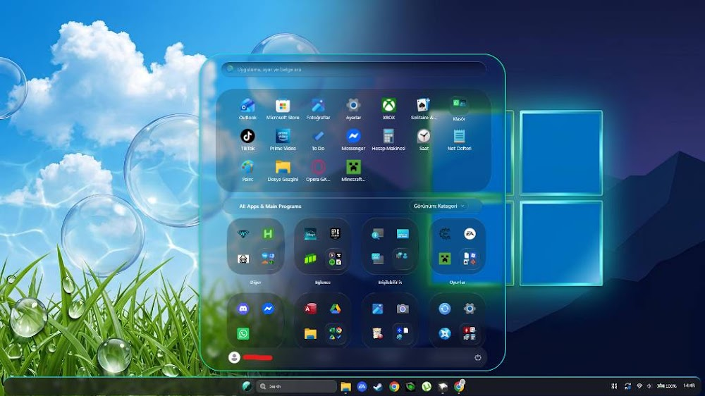
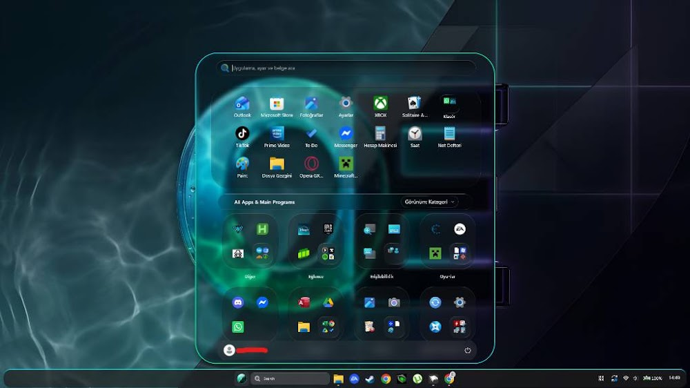
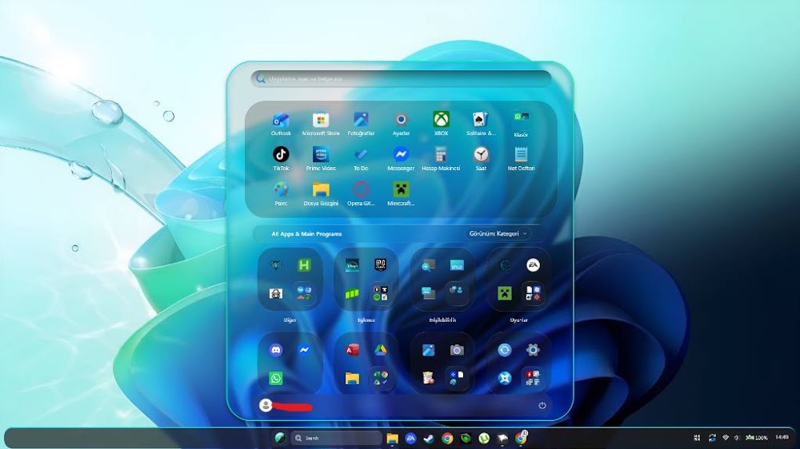

# Œro (`oero-theme`)

**Œro** (pronounced *Oero*, typed `oero` on standard keyboards) is a Windows 11 theme that fuses **2009 Frutiger Aero** glossy glass with **modern dark mode**.

The name uses the **Œ** ligature because it merges two letters into one single glyph—just like this theme merges two eras of Windows UI design into one desktop.
---

## Previews

### Horizon Wallpaper (`oero_horizon`)

### Emblem & Bloom Wallpapers

| Emblem (`oero_emblem`) | Bloom (`oero_bloom`) |
| :---: | :---: |
|  |  |

---

## What's in v0.1 (`oero-desktop`)
* **3 Custom QHD+ Wallpapers (`assets/wallpapers/`):**
  * `oero_horizon.png` — Diagonal blend of classic Windows 7 grass-and-sky Aero with dark Windows 11 mountains and glowing glass squares.
  * `oero_emblem.png` — The signature fused **Œ** logo (bubbly cyan/emerald Aero **O** + neon-edged dark **E**).
  * `oero_bloom.png` — Smooth diagonal fusion of glossy water droplets and the dark Windows 11 Bloom flower.
* **Custom "Œ" Start Button Orb (`assets/icons/oero_start_orb.png`)**
* **Windhawk Configs (`configs/`):**
  * Full-length frosted dark-glass taskbar with a glowing cyan-to-emerald Aero top highlight (`taskbar.json`)
  * Custom taskbar height & icon scaling (`taskbar-size.json`)
  * LiquidGlass refraction Start menu with diagonal Aero border glow (`start-menu.json`)
  * Start button orb replacer config (`start-orb.json`)

---

## How to Install (Windows 11)

## How to Install (Windows 11)

1. Create a System Restore Point first to be safe.
2. Download and install [Windhawk](https://windhawk.net).
3. Install these five Windhawk mods from the **Explore** tab:
   * `Windows 11 Taskbar Styler`
   * `Windows 11 Start Menu Styler`
   * `Start Button Replacer`
   * `Taskbar height and icon size`
   * `Windows 11 File Explorer Styler`
4. Open each mod's **Advanced** tab, paste the matching `.json` text from the `configs/` folder (`taskbar.json`, `start-menu.json`, `start-orb.json`, `taskbar-size.json`, `explorer.json`), and click **Save settings**.
   * *(In `Start Button Replacer`, update the image path to wherever you saved `oero_start_orb.png` on your PC.)*
5. Right-click your favorite wallpaper from `assets/wallpapers/` and select **Set as desktop background**.
6. **Opera GX (Optional):** Open `opera://extensions`, enable **Developer mode**, click **Load unpacked**, and select the `apps/opera-gx/` folder.
7. **Discord (Optional):** Set Discord's Appearance to standard **Dark** (disable Nitro themes), then copy `apps/discord/oero-discord.theme.css` into your **Vencord** / **BetterDiscord** `themes` folder and toggle **Œro Discord** on.

---

## Roadmap

* **v0.1 — Desktop Edition:** Wallpapers, custom Start orb, glass taskbar, and Start menu.
* **v0.2 — Apps Edition** *(Current)*: Translucent File Explorer (`explorer.json`), `Œro GX` Opera GX mod, and `Œro Discord` theme.
* **v0.3 — Full Shell Polish** *(Next)*: Custom Aero cursors, system icons, and sound pack.

---

## Note on Assets & Contributing
I'm a 13-year-old solo creator building **Œro** from scratch with zero budget, so the wallpapers and **Œ** Start orb were generated with AI to bring the visual idea to life. If you're a designer, coder, or theme maker who wants to contribute hand-crafted icons, cursors, or app CSS themes, pull requests and issues are always welcome!
